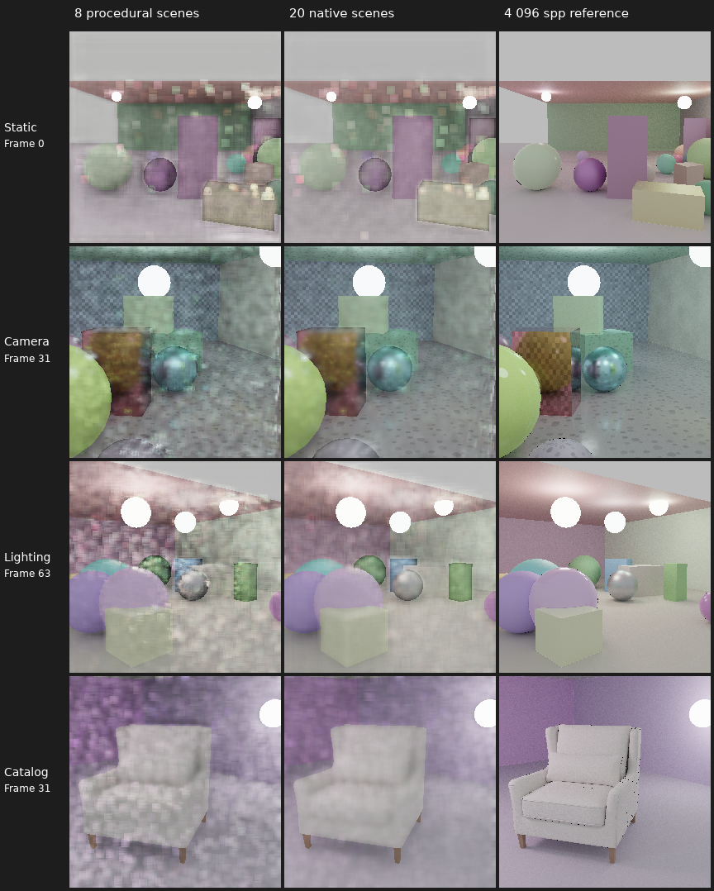
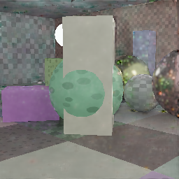
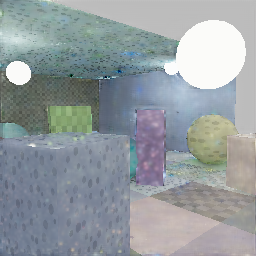
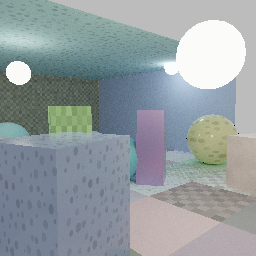
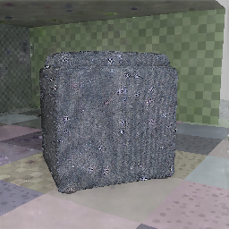
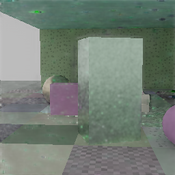
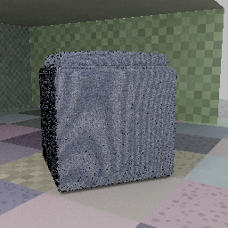

# ommatidia

[](https://github.com/kvark/ommatidia/actions/workflows/check.yml)

Neural reconstruction of sparse path-traced frames, in Rust on
[Meganeura](https://github.com/kvark/meganeura) and
[Blade](https://github.com/kvark/blade).

One model: a **recurrent kernel/direct-radiance U-Net (v4, F1)**. It reconstructs
diffuse illumination and specular radiance, then applies observed material albedo
and emission, learning history blending and a latent recurrent state. At 2x scale
it has 657,792 parameters and 2.15 convolution GFLOP/frame at 128×128 → 256×256.
Inputs include 1-spp low-resolution radiance, motion/jitter and
output-resolution primary surfaces.

Before F1, the GPU-cursor training loop reached **7.41 million valid pixel-gradients/s,
24.77× the earlier loop**, on the RX 7900 XT with the 40-scene profiling corpus.
This is training throughput, not a quality claim;
[measurement and accounting](docs/training-profile.md#phase-3-cursor-loop).

The [verified training corpus](docs/training-corpus.md) now contains **200 scenes /
12,800 frames**. The initial Phase 5 ladder missed Decision A; the owner approved
the single F1 fallback. [Results and gates](docs/phase5-results.md).

## Measured results

### F1 development

F1 produces cleaner moving frames when trained on the five scene types at
the benchmark resolution. The 20-scene set includes moving lights and
authored objects. The eight-scene set contains smaller procedural scenes.
Both use 1-spp inputs, 1,024-spp training targets and 12,000 updates.

The table uses the same ten development sequences, 640 frames, continuous
history and 4,096-spp references at 256×256. Each F1 cell gives seeds 1 / 2
trained from scratch with the shipping Meganeura kernel.

| Training data | Mean PSNR (dB) ↑ | Mean FLIP ↓ | Temporal MSE ↓ |
|---|---:|---:|---:|
| Corrected v3 | 30.27 | 0.10775 | 0.000359 |
| F1 · 8 procedural scenes | 26.08 / 25.54 | 0.18724 / 0.20469 | 0.000575 / 0.000578 |
| F1 · 20 native-resolution scenes | 27.94 / 27.76 | 0.15160 / 0.15208 | 0.000367 / 0.000433 |

The 20-scene fits gained **1.87 / 2.21 dB** over the eight-scene controls.
The gain also held with fixed-order warp gradients, which made a repeated
12k fit bit-identical. On eight separate scenes with two independent 1-spp
inputs, those models reduced output variation from path noise by
39% / 18%. Corrected v3 still leads on the full development benchmark.
[Reset behavior, fixed crop errors, noise measurements and training details](docs/warp-gradient.md).

The pictures compare the two fixed-order seed-1 models on complete
256×256 development frames.
Look at the floor under the moving camera, the wall behind the lights and
the chair cushions. The larger training set reduces blotching. The
reset frame still shows square patches and the chair seams remain blurred.



### Published v3 audit

These retained pictures and numbers use the **pre-fix v3 decoder**, not today's
runtime or a trained v4 model. The checkpoint is unchanged; see the
[runtime archive and reproduction notes](docs/archive/README.md).
The [adopted v4 plan](PLAN.md) replaces the runtime; these archived results will
be replaced only after v4 quality evaluation. Implementation progress and
outstanding checks are in [the run ledger](docs/experiments.md).

Fresh-scene audit: **256 frames**, 1-spp 128×128 input → 256×256 output,
16-frame causal sequences, 4,096-spp references. The same model was fine-tuned
for 4,000 updates at this resolution. Development selected the final checkpoint
before the audit. Both checkpoints receive identical frames and run their own history.

| Audit | PSNR, previous → now ↑ | SSIM, previous → now ↑ | Temporal error ↓ |
|---|---|---|---|
| Procedural scenes | 28.18 → **28.65 dB** | 0.823 → 0.837 | −7.7% |
| Held-out object scenes | 28.91 → **29.60 dB** | 0.797 → 0.816 | −7.8% |

The comparison is against the previous **trained checkpoint**, not just the fixed
guide. PSNR improves on 246/256 frames; the worst regression is 0.26 dB.
The unchanged, previously published audit also improves: **28.24 → 28.67 dB**
(procedural) and **29.04 → 29.79 dB** (objects).

Mean energy bias on the fresh audit is now −0.40% / approximately 0%, down from
+1.34% / +2.58%. Specular noise, blotches and missing detail remain.
[Full metrics, protocol, hashes and limitations](docs/results/README.md).

Sequence 0, frame 7 in each set, chosen before evaluation. Native 256×256
outputs; identical display transform, no retouching.

| Previous checkpoint | Fine-tuned checkpoint | Reference |
|---|---|---|
|  |  |  |
|  |  |  |

Object assets: Amazon.com, [ABO / CC BY 4.0](docs/catalog.md). Authored objects
replace the extra primitives; measured visible coverage is 4.2–40.5% per audit
frame. Scene seeds and asset families are disjoint from training and development;
these are fresh scenes using the same four audit families as the previous report.

## Build and train

Rust 1.92+. Cargo fetches Meganeura `25ed41c`, Blade `d9112e2` and Blade's
Naga fork `9964733`, which includes the workgroup-layout fix. Capture loads WGSL
from that same Blade revision. The catalog unit test uses two example meshes
from a sibling Blade checkout.

```sh
# For a fresh test checkout
git clone https://github.com/kvark/blade ../blade && \
  git -C ../blade checkout --detach d9112e26ab1244d9e206e7d27387295a28cb3fa3
cargo +1.92.0 test --workspace --locked
cargo build --release --workspace
cargo run --release -p ommatidia-train --bin transport -- \
  --data data/train.omd --eval-data data/dev.omd --out runs/model \
  --steps 5000 --channels 16 --unroll 4 --batch 8 --crop 64 --lr 0.0003
```

[Architecture and runtime](docs/design.md) ·
[Data, metrics and reproduction](docs/evaluation.md) ·
[External asset capture](docs/catalog.md)

The [Blade integration example](ommatidia/examples/blade.rs) records preparation,
Meganeura inference and resolve into the renderer's own encoder, with one
submission and no intermediate CPU wait:

```sh
cargo +1.92.0 run -p ommatidia --example blade --locked -- 0x744c
```

The device ID is optional. This headless scheduling example uses synthetic
observations and initialized weights; it does not demonstrate trained quality.

## Scope

This is a reconstruction research prototype, not demonstrated DLSS parity.
The training corpus is still small and synthetic; game traces, broad interiors,
and matched external-denoiser comparisons remain missing.

The old diffusion, kernel-selector, field/relighting, C ABI, trainers and result
galleries were removed. They remain at tag `archive/experiments-2026-09-25`
(`e0922c6`). There are no hidden
architecture switches or compatibility interpretations of their weights.
The retained runtime is `ommatidia::transport::native::Native`, config version 4.
It rejects v3 weights; use the archived executable to reproduce the gallery.

F1 passes 103 regular tests and thirteen GPU gates on both RADV and LavaPipe with
zero validation errors, including recurrent HDR/reset parity, f64 gradients,
production-size directional gradients, mean-gradient accumulation, GPU cursor
carry, optimizer/cursor resume, caller-encoder parity, reset-motion independence
and exact reload. Fresh LavaPipe captures
also pass the trainer/evaluator integration smoke. [Recorded runs](docs/experiments.md).
