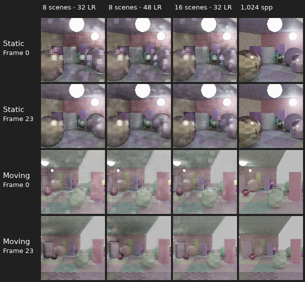

# F1 training context and scene diversity

Keep the original F1 crop recipe. Extra input context missed the quality
criteria for both seeds. Twice as many training scenes improved mean FLIP in
both, but only seed 1 improved warm PSNR. Repeating the same control command
also moved warm PSNR by 0.63 dB.

## Results on the original development set

Both wider-context runs lost warm PSNR and increased mean FLIP. Cold PSNR
improved, and temporal MSE fell, but the wider window also increased warm
smooth-region MSE by 24% and 31%. The 16-scene runs lowered mean FLIP in
both seeds. They split on warm PSNR. Seed 1 gained 1.38 dB on moving-object
sequences and 0.72 dB on moving lights, while seed 2 lost 1.12 and 0.72 dB
on those cases. These are case means across two scenes each. On the final
frame of the second lighting sequence the 16-scene seed-2 run lost 4.56 dB.

| Candidate | Seed | Cold ΔPSNR, causal / reset-16 | Warm causal ΔPSNR [95% CI] | Causal ΔFLIP ↓ | Causal temporal MSE change ↓ |
|---|---:|---:|---:|---:|---:|
| Wider input | 1 | +0.38 / +0.37 dB | −0.17 [−0.75, +0.37] dB | +0.00601 | −9.9% |
| Wider input | 2 | +0.22 / +0.22 dB | −0.02 [−0.55, +0.54] dB | +0.00108 | −8.0% |
| 16 scenes | 1 | +0.88 / +0.91 dB | +0.67 [+0.15, +1.18] dB | −0.00603 | −28.0% |
| 16 scenes | 2 | +0.18 / +0.05 dB | −0.53 [−1.48, +0.29] dB | −0.00124 | +8.3% |

Differences use matched training seeds against the eight-scene, 32×32 control.
Each interval covers scene sampling within that pair. Warm means at least 16
frames since reset, giving 480 warm frames under continuous history. Resets
every 16 frames yield 40 cold frames and no warm frames.

On the separate paired-noise panel, more training scenes reduced repeatable
RGB error by 19.4% and 11.8%. Sensitivity to the noisy input changed by
+3.0% and −13.6%. On the original benchmark, warm smooth-crop MSE fell 25.5%
for seed 1 and rose to 2.81× its control for seed 2 (ratio interval
0.68–7.84). Even the better run loses the reflections on the left sphere,
and all three seed-1 outputs show bands across the moving room’s wall.

The cold center probe compares identical pixels under 32² and 64² LR inference.
Wider training context lowered the mean squared difference between those
predictions by 20% in seed 1 and 2% in seed 2. Training on more scenes lowered
it by 39% and 78%. Neither change in context sensitivity predicted warm
accuracy on the ten-scene benchmark.

## What the comparison held fixed

For each seed, all 12,000 learning rates, reset decisions, sampled slots
and target-pixel counts matched the original control. Both runs saw 24,000
four-frame training windows. The wider input kept the RGB and radiance
targets, spatial masks and pooling weights on the same output pixels.
It also exposed prior-frame samples across the old crop edge. Replaying
the captured motion and both samplers found extra bilinear taps at 5,866
of 227,801,952 temporal destinations in seed 1 and 4,257 of 227,765,952
in seed 2. Of these, 1,911 and 1,439 respectively gained valid history.
This comparison measures the combined effect of spatial and recurrent context.

The 16-scene run used the same sequence-slot draws and reset schedule.
Eight slots now point to different scenes. The trainer also recomputes its
initial radiance bias from the new training-set means, as it does in normal
training. The new scenes used the same 1-spp estimator, reference sampling,
renderer flags and scene types as their corresponding controls.

## Training repeatability

The first byte-for-byte check between a resumed six-update fit and a fresh
fit failed. Reloading each saved checkpoint preserved every parameter.
Compared by tensor name, the resumed run and the uninterrupted run differed
by at most 1.49×10⁻⁸ in model/Adam values and 2.39×10⁻⁷ in recurrent state.
An independent uninterrupted repeat also differed. An existing zero-context
checkpoint resumed through update 5,001.

To measure how much this matters at 12k, we replayed the original controls
with the new trainer and repeated its seed-1 command a second time with the
same executable, captures, sampler and GPU. The two seed-1 repeats first
differed in logged loss at update 44. They finished at **26.54 and 25.91 dB
warm PSNR** on the same 480 frames (difference −0.63 dB, paired scene
interval [−1.88, +0.33]). This single pair measures an observed spread.
It cannot estimate the full distribution across training runs. Relative
to the new trainer’s first controls, the 16-scene warm changes were still
+0.41 and −0.48 dB.

Two 128-update repeats at a one-frame unroll matched every model and Adam
tensor, cursor state and logged loss. At the normal four-frame unroll,
118 of 120 tensors differed, with maximum absolute differences of 1.08×10⁻⁷
in model/Adam tensors and 1.43×10⁻⁴ in recurrent state. This narrows the next
test to training through time. The one-frame run also changes the sampled
trajectory and temporal loss, so this check does not identify a faulty kernel.

## Decision

Keep the original training crop as the default. The data result supports
investigating coverage of lighting and reflective objects. It falls short of
the two-seed threshold for carrying this intervention into the 60k schedule.
For the next quality iteration, replay one saved four-frame minibatch from
identical model and Adam state and compare the recurrent warp gradients
against a fixed-order reference. Measure the effect of any correction on
12k repeatability and on held-out FLIP and warm PSNR. The 200-scene,
60k F1 benchmark remains the production-scale comparison.

The [machine-readable results](crop-context.json) include both reset protocols,
per-age metrics, fixed smooth-crop errors and intervals, per-case scores,
moving-light final frames, the independent-noise estimates and the cold center
probe. The [run ledger](experiments.md) identifies the captures, fits and scores.

## Protocol recorded before training

Use the two existing single-stream, 12,000-update F1 controls from the
[quality iteration](quality-iteration.md). Train two candidates from scratch
with seeds 1 and 2 on the same eight scenes. The sampler still draws two
32×32 LR target windows per update and four frames per window. Expose 48×48
LR pixels to the candidates. Shift the extra context toward the interior
near physical edges, in multiples of eight LR pixels to preserve both the
encoder stride phase and the 4×4 low-frequency loss grid. Keep the original
four-output-pixel margin on artificial target edges and supervise real image
edges. Check target values, masks, normalization, cursor choices and the
per-update count of supervised pixels against the controls.

Evaluate the final checkpoint on the ten restored development sequences
under continuous history and resets every 16 frames. Pair by scene and
reference hash, using the same 1,000 whole-sequence bootstrap draws (seed 31).
Measure FLIP, PSNR by reset age, the 40 fixed crop/frame selections, temporal
MSE, energy and moving-light final frames. Use the separate eight-scene
paired-noise panel for noise sensitivity, the original cold-frame center
crop probe for context sensitivity, and the same four preselected pictures.

Advance to the full corpus if both seeds lower causal FLIP, improve warm PSNR
with a positive 95% lower bound and lose at most 0.1 dB of cold PSNR under
either protocol. Check cold and warm smooth-crop MSE, temporal MSE and
energy before accepting any tradeoff. On a miss, test distinct scene count
at the same 12k budget with the original 32×32 context and seed pair. Replace
the duplicate input captures with four new static and four new moving scenes
(base seeds 18031001 and 18032001) at the original capture settings.

To reproduce the training change, add `--context 8` to the control's
`transport --crop 32` command. The radius is in LR pixels per side.
It must be a multiple of the encoder and pooling stride and leave room for
every sampled stride phase. The default radius is zero. A training resume
uses the original radius and restores the full input window's recurrent
state. Inference takes the same F1 checkpoint and graphics inputs as before.
