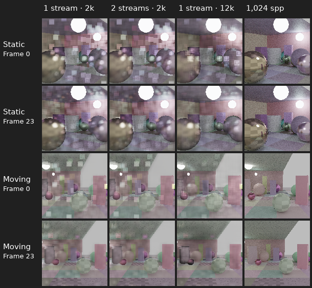

# F1 quality iteration

F1 trained for 12k updates on eight procedural scenes scored **25.91 dB
and 0.19015 FLIP** on the original ten development sequences, compared with
**30.27 dB and 0.10775** for corrected v3. The same 640 frames are now
reproducible, including authored objects, motion and changing lights.
Longer training reduces speckle but leaves repeatable errors in the lighting.
The strongest next test is to enlarge the context around the supervised pixels.

## First question

Does showing the same surface under a second independent 1-spp realization
help F1 suppress noise on **unseen scenes**? Each scene in the 200-scene corpus
has one recorded noise trajectory. A network can learn the errors in that
trajectory. Changing only training noise lets us test that explanation.

## Experiment fixed before capture, 2026-11-18

1. Use the current Meganeura/Blade pins and the single 16-channel, four-level
   F1. Capture procedural scenes on RADV with its existing Mesa 26.2.3 setup.
   Quality runs can share the RX 7900 XT. Leave other jobs running.
2. Capture eight training and eight development scenes. Each split has four
   static scenes and four with camera, object and light motion. Base seeds in
   that order are 18011001/18012001 for training and 18021001/18022001 for
   development. Use 24 jittered frames per scene, 64² 1-spp inputs, 128²
   output guides, 1,024-spp references, eight bounces, canopy, gloss, texture
   and eight ground patches. Moving cases use 0.03 camera and object motion
   and 0.05 light motion. Keep every frame.
3. For each training case render a second stream with LR path-frame offset
   512. Check high-resolution targets/guides and the observed input geometry
   for equality, the LR radiance for differences, and actual seeds for split
   overlap. The control lists the first two captures twice. The challenger
   substitutes the second noise stream in the last two slots. This preserves
   scene ordering, sampling probabilities, window count and target means.
4. Train both from scratch with seed 1, 2,000 updates, two 32² crops per
   update, four-frame unroll and the same default objective, augmentation and
   learning-rate schedule. Score only the final checkpoints. Compare paired
   development sequences under causal and reset-every-16 evaluation. Report
   PSNR, official FLIP, temporal error, cold/early/warm behavior, energy and
   each moving sequence's final frame. Use 1,000 paired whole-sequence
   bootstrap draws (seed 31). Show static sequence 0 and moving sequence 4,
   frames 0 and 23, at the same display transform.
   On a second causal development noise stream (offset 512, identical HR
   targets), estimate noise sensitivity as half the mean squared difference
   between the model's two predictions in compressed RGB. Subtract this from
   the mean of the two reference errors to estimate the repeatable component.
   Report both so that merely blurring the image cannot count as denoising it.
5. Advance a data change if causal warm PSNR improves (95% lower bound above
   zero), mean causal FLIP falls, and cold PSNR loses at most 0.1 dB in both
   protocols. Repeat the pair with seed 2 if the warm interval crosses zero.
   If it still overlaps, report uncertainty and keep the current recipe.
   Inspect the lobe and temporal errors for the next hypothesis. Do not select
   a checkpoint or promote the gallery on this small panel.

The next milestone is the 60k F1 evaluation on the original hashed 200-scene
corpus and ten development sequences against the learned v3 control. Check
recovered captures, checkpoint and control against their recorded identities.
If they cannot be recovered, qualify regenerated inputs by hash. Any newly
captured benchmark requires a matched control before making a quality claim.
The frozen [Decision A criteria](../PLAN.md#9-phase-5-training-ladder-and-decision-point-a-3-days)
apply there. Confirmation stays reserved for the selected final model.

## Fixed follow-up on training duration

The first pair improved warm PSNR but missed the mean FLIP gate. Keep the
single-stream input. Before running the follow-up, fix a single 12,000-update
fit from scratch, with the same seed, sampler, data and objective as the
2,000-update control. The planned cosine schedule stretches with the budget.
Score only the last update against the original control, with the same held-out
noise pair, image selections, metrics, bootstrap and advancement thresholds.
Record whether the reference-relative gradient error and the repeatable RGB
error improve as well. This tests the benefit of more optimization on eight
training scenes. The official corpus and the v3 comparison remain separate.

## Transfer to the original development benchmark

The September static development capture regenerated bit-for-bit. Its two
64-frame scenes provide a transfer test at the original 128² → 256² resolution
and 4,096 spp. Compare the 2k and 12k one-stream models there. Use the old
capture executable, Blade shaders at `fbb4f28` and the original generation
settings to recover the remaining four cases. Check every file against
[the frozen hashes](training-corpus.json) before evaluating the 12k model on
all ten sequences. Report the difference from the archived corrected v3
aggregates, including smooth crops and FLIP. The archived aggregates support
point differences. Paired intervals against v3 require its per-frame outputs.

All five development captures, their six sidecars and the two original ABO
catalog lists matched their archived SHA-256 values. The five captures total
2,629,828,928 bytes. They are available at the original paths under
`runs/quality-week-2026-09-26/data`. Recovery used the existing September
`target/release/ommatidia-data` (SHA-256 `d33e008c…`), Mesa 26.2.3, the RX
7900 XT, and the [original per-case settings](archive/quality-week.md#fresh-final-audit-specification)
with development base seeds 610001 through 650001 in increments of 10,000.
The procedural and authored-object inputs both reproduced exactly.

| Original development case | 12k F1 causal PSNR ↑ | 12k F1 causal FLIP ↓ |
|---|---:|---:|
| Static | 29.11 dB | 0.15199 |
| Camera motion | 25.64 dB | 0.21623 |
| Object motion | 25.44 dB | 0.17720 |
| Moving lights | 24.98 dB | 0.19428 |
| Authored objects | 24.40 dB | 0.21103 |

On the two original static scenes, increasing training from 2k to 12k raised
PSNR by 0.67 dB but worsened FLIP from 0.13849 to 0.15199. Across all ten
scenes, 12k F1's smooth-crop error was **5.78× v3 on cold frames, 9.13× on
early frames and 4.47× on warm frames**. Both evaluations used the same
40 predeclared crop/frame selections. Resetting every 16 frames yielded
24.81 dB and 0.21699 FLIP for F1, versus 29.61 dB and 0.11929 for v3.
This reset protocol never reaches warm age. Five saved frame-3 reference PNGs
matched the original digests exactly.

## Independent training noise

At 2k updates, a second input-noise realization cut sensitivity to the input
samples by **11.5%** (95% interval 7.4–15.8%). The repeatable part of RGB
error **grew 3.5%** (1.0–6.4%). Warm PSNR rose by 0.172 dB [0.091, 0.262],
but all-frame FLIP rose from 0.18154 to 0.18184 (difference +0.00030
[−0.00092, +0.00144]). This looks like a trade of fine detail for stability.
Keep the single-stream recipe. The warm PSNR interval excluded zero, so the
predeclared rule did not trigger a second seed. All intervals here resample
scenes and describe this training seed only. The repeatable error includes
any noise in the shared finite-sample reference.

## Training duration on unseen scenes

For seed 1, training the one-stream model longer cut input-noise sensitivity
by 62% and raised repeatable error by 56%. Cold PSNR rose by 0.75 dB.
Warm PSNR rose by 0.42 dB, with a paired interval of [−0.06, +0.92] dB.
The 12k model improved reference-relative gradient error by 7.8%, but mean
FLIP worsened from 0.18154 to 0.19078. Individual moving-scene final-frame
PSNR changes were −0.67, +0.10, +1.11 and +0.35 dB. The warm interval
triggered the predeclared second seed for this duration comparison.

| 2k → 12k, eight unseen scenes | Seed 1 | Seed 2 |
|---|---:|---:|
| Cold PSNR change ↑ | +0.75 dB | +0.73 dB |
| Warm PSNR change ↑ (95% interval) | +0.42 [−0.06, +0.92] dB | −0.18 [−0.78, +0.34] dB |
| Mean FLIP ↓ | 0.18154 → 0.19078 | 0.17905 → 0.19611 |
| Temporal MSE change ↓ | −26.3% | −23.9% |
| Input-noise sensitivity change ↓ | −62.3% | −56.7% |
| Repeatable RGB error change ↓ | +56.4% | +67.8% |

The longer fit steadied the output in both seeds. Its warm PSNR gain changed
sign, and its perceptual score worsened in both. Both eight-scene interventions
missed the quality gates. The 12k checkpoint reproduces the lighting artifacts.
[Metrics by age, lobe, noise stream, reset protocol and moving-scene final
frame, with checkpoint and capture identities](quality-iteration.json).

## What the images show

All four rows were selected before training. Each tile contains the original
128×128 evaluation PNG pixels. The 12k model suppresses more of the changing
speckle, but still places patches of light on the static room's ceiling and
loses reflections from the foreground sphere. At frame 23, horizontal bands
cross the left side of the moving room where the reference shows a smooth wall.

Two follow-up checks investigated the patches on development frames. Both
are exploratory.

- **Screen position.** Compare predictions for the same frame under two
  independent noisy inputs. At 2k, the mean squared change in that difference
  across 16-output-pixel grid boundaries was 1.41× the value across other
  edges (2.23× on cold frames). The raw input-noise difference on the matching
  eight-input-pixel grid had a ratio of 0.97×. The model output shows a
  dependence on screen position. Identifying its source takes a separate test.
- **Crop context.** For each of the eight cold frames, evaluate an aligned
  32² LR center crop and the full 64² LR frame. Compare the identical central
  32² output pixels, preserving the encoder stride phase. At 2k the change in
  prediction had compressed RGB MSE 0.000042, rising to 0.000667 at 12k.
  At 12k the smaller context actually had lower mean reference error
  (0.00593 versus 0.00648), though only four of eight scenes improved.
  This makes training context worth isolating in the next experiment.

## Next quality experiment

1. Keep the F1 graph, target pixels, one-stream input, crop locations and
   training schedule fixed. Compare the current crop with a larger window
   around the **same supervised pixels**. Mask the additional pixels out of
   the loss and preserve real image boundaries. Verify that crop and full-frame
   references agree on the supervised rectangle. Use both training seeds.
2. Evaluate the whole 10-sequence development benchmark, including moving
   lights, disocclusions and authored objects. Report FLIP, cold and warm
   smooth-crop MSE, temporal error, energy, output-noise sensitivity and the
   crop-context probe. Keep the image selections fixed. A drop in temporal
   error alone cannot establish a visual improvement.
3. Carry a successful change into the 60k schedule on the original 200-scene
   corpus. Qualify each regenerated training shard by its archived hash.
   If wider context misses the quality gates, keep the current crop recipe
   and test more distinct training scenes at the same optimizer budget.
   Decision A and the separate confirmation set govern gallery publication.
