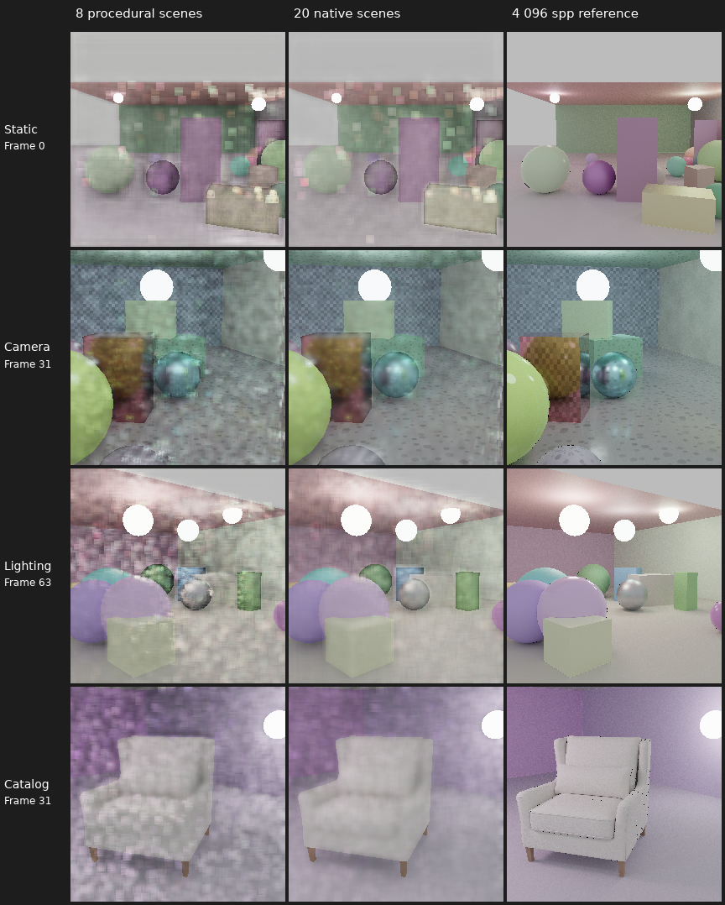
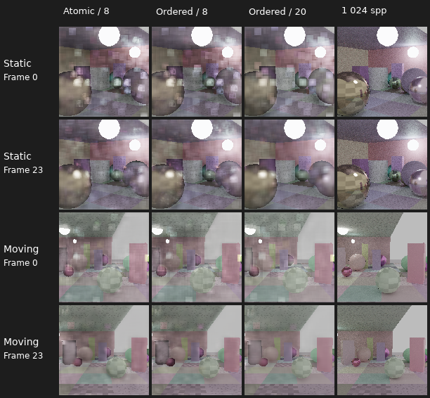

# F1 quality, training data and recurrent warp repeatability

**Training on 20 native-resolution scenes improved F1 on both seeds and both
training backends.** With the shipping trainer, the mean causal scores rose
from 26.08 / 25.54 to **27.94 / 27.76 dB** and FLIP fell from
0.18724 / 0.20469 to **0.15160 / 0.15208**. Corrected v3 scores 30.27 dB
and 0.10775 on the same 640 development frames. The repeatable training
backend isolated the data effect and enabled independent checks on noise,
reset behavior and fixed spatial crops.

## What changed in the pictures



The moving-camera floor and the walls under changing lights show fewer
blotches. The chair cushion is smoother, but its seams and the reflections
on the spheres are still blurred. Both models break up the cold frame's
flat ceiling into patches. These four full-resolution frames were fixed
before the 20-scene fits. All columns use the same exposure and display
transform.

| Ordered trainer, 20 vs 8 scenes | Seed 1 | Seed 2 |
|---|---:|---:|
| Cold ΔPSNR, continuous / reset-16 | +1.27 / +1.16 dB | +1.52 / +1.26 dB |
| Warm ΔPSNR, continuous [95% CI] | +2.30 [+1.76, +2.86] dB | +4.87 [+3.27, +6.79] dB |
| Mean causal ΔFLIP ↓ | −0.03964 | −0.07932 |
| Causal temporal MSE change ↓ | −58.2% | −29.3% |
| Cold / warm smooth-crop MSE ratio ↓ | 0.60 / 0.45 | 0.67 / 0.21 |
| Mean causal energy ratio (ideal 1.0) | 1.0006 | 0.9923 |

Both seeds passed the development advancement criteria. Warm covers 480
frames with history age at least 16. Reset-16 supplies 40 cold frames.
The fixed smooth-crop comparisons cover five sequences. For seed 2 the
cold ratio interval, 0.51–1.37, includes no change. One lighting case
also regressed. Seed 1 lost 1.95 dB on the final frame of lighting sequence
7, even as its full-benchmark temporal MSE fell. Seed 2 gained on that frame.

The shipping-kernel cross-check gained 1.87 dB [1.06, 2.90] and 2.21 dB
[1.63, 2.72] in overall PSNR. Warm gains were 1.83 and 2.28 dB. The
smaller gain relative to the ordered experiment in seed 2 reflects its
stronger eight-scene atomic control.

On the separate eight-scene paired-input test, changing only the random
paths in the 1-spp input moved the 20-scene model's predictions less.
Input-dependent error fell 39% and 18%. Repeatable error changed by +0.2%
and −22%. The remaining block-shaped patches and missing reflections in
the smaller rooms are visible even with accumulated history.



The 12k comparison tests the combined training-data change. It establishes
a gain at the development resolution on independent scenes. Attribution
to resolution, scene content, or longer history individually would require
matched captures. [Machine-readable metrics and checkpoint hashes](warp-gradient.json)
and [recorded runs](experiments.md).

## Why the same seed produced different checkpoints

A bilinear warp gathers samples from the previous frame. During backward
propagation several output pixels can send gradient to the same source pixel.
The shipping large scalar scatter uses floating-point atomic additions.
Scheduling changes their order, and f32 addition rounds at each step.

From the saved step 5,035, both minibatch losses and both forward recurrent
states repeated exactly in all 16 replays of each backend. On the last cursor,
the first backward tap, `f3.warp3`, returned different sums for identical
indices and source gradients. Across all 12 taps and 16 replays, 485 of
13,369,344 destination reads differed from ascending-order f32 on the shipping
kernel. The largest absolute difference from the f64 sum was 4.34×10⁻¹³.
Every destination on both implementations was within its f32 error bound.
The evidence identifies a reduction-order sensitivity. These measurements
support the numerical correctness of the original scatter on this batch.

| Replayed quantities | Shipping atomics | Fixed source order |
|---|---:|---:|
| Largest parameter-gradient change, 16 frozen replays | 5.82×10⁻¹⁰ | 0 |
| Model or Adam tensors differing after one normal update | 64 / 120 | 0 / 120 |
| Model or Adam tensors differing after two same-seed 12k fits | 120 / 120 | 0 / 120 |
| Logged losses differing across those 12k fits | 11,936 / 12,000 | 0 / 12,000 |

The ordered seed-1 repeats also match on every recurrent-state byte and
every row of the trainer's final evaluation. Their checkpoint SHA-256 is
`bf34917069f70f8ae34ccfc92a42d02fafdf60c946e58ca3e9d0415c5565f61f`.
This establishes repeatability for these two fits on this adapter and
software stack. Seeds 1 and 2 still sample different training trajectories.
The synthetic scalar scatter matched the ordered f32 reference, including
the 9- and 33-contributor fallback, on both RADV and LavaPipe.

## Image quality from the reduction change alone

On the eight-scene recipe, the first matched atomic replays beat the ordered
fits in mean causal PSNR and FLIP for both seeds. Seed 2 lost 6.07 dB on
moving objects and 3.27 dB on moving lights, averaged over two scenes each.
The two seeds saw identical training data, settings and sampling as their
respective controls. Each confidence interval resamples the ten evaluation
scenes within one training-seed pair.

| Seed | Overall PSNR, atomic → ordered | Warm PSNR difference [95% CI] | Mean FLIP, atomic → ordered |
|---|---:|---:|---:|
| 1 | 26.08 → 25.64 dB | −0.54 [−1.13, +0.08] dB | 0.18724 → 0.19316 |
| 2 | 25.54 → 23.29 dB | −2.71 [−4.69, −0.93] dB | 0.20469 → 0.23330 |

Using the second atomic seed-1 replay instead changes the estimated warm
difference to +0.09 dB [−0.51, +1.03], and the FLIP difference to −0.00162.
The reference reduction makes paired experiments reproducible on this setup.
Its measured quality falls short of the advancement criteria.

## Experiment protocol

Replay update 5,036 from a saved eight-scene F1 training run. Both cursors
advance through moving frames 4–7. Fix the weights, Adam state, recurrent
state, sample order and GPU. Compare the shipping Meganeura gradient for
bilinear history sampling with a training-only version that sums contributions
in ascending source-pixel order. Check individual warp sums against a CPU
reference and compare complete saved updates by tensor name.

Train the ordered implementation twice with seed 1 and once with seed 2 for
12,000 updates from scratch, using the original 32×32 crops and four-frame
unroll. Compare with the first same-seed replays from the previous experiment.
Use the second existing seed-1 replay to measure sensitivity to the chosen
control. Evaluate the final weights with the same pinned inference executable
on ten development sequences. Score continuous history and resets every 16
frames, the locked crops, and paired whole-scene intervals (1,000 draws,
seed 31). Keep the previous advancement criteria for both seeds. Causal FLIP
must decrease, the lower bound on warm PSNR improvement must exceed zero,
and cold PSNR may lose at most 0.1 dB under either reset protocol.

## Follow-up on training data

With the summation order fixed, test whether F1 transfers better when its
training data include the five development case types at the same resolution.
Recover the first four training scenes per case from the archived 200-scene
manifest. Verify each capture, provenance sidecar and catalog selection by
SHA-256 before training. Fit the same two seeds and 12k schedule from scratch
and compare against the ordered eight-scene controls. This comparison changes
scene distribution, resolution, sequence length and the resulting cursor
schedule together. Use the same advancement criteria, development frames,
reset protocols and fixed pictures. These are development experiments.

Show the seed-1 native-resolution model beside its ordered eight-scene
control and the reference on development frames 0:0 (static), 2:31 (camera),
6:63 (lighting) and 8:31 (catalog). Show complete frames with the common
display transform. Use the original four 128×128 frames to check transfer
back to the smaller procedural scenes.

The 20-scene pilot uses four archived training scenes from each of the
static, camera, moving-object, moving-light and catalog cases. Each scene
has 64 frames at 128×128 input resolution and 256×256 output resolution.
The eight-scene control has 24 frames at 64×64 and 128×128 respectively,
with four static scenes and four that combine motions. Both use the same
1-spp input estimator, 1,024-spp training references, four-frame unroll,
two crops per update and 32×32 LR training crop. With longer sequences the
sampler can carry history longer and resets less frequently. Each trainer
initializes the radiance bias from its own training-set means.

To measure visible noise separately from persistent errors, evaluate each
seed on two independent 1-spp realizations of the same eight small
development scenes (192 frames per stream). Half the mean squared change in
compressed RGB estimates the output variance due to path noise. The
cross-product of the two errors against their shared reference estimates
repeatable error. These measurements describe the smaller scenes.

As a secondary check, train both seeds on the same 20 verified scenes with
the shipping Meganeura kernel. Compare causal scores against the original
eight-scene replays from the same executable. This checks whether a data gain
also reaches the normal training path. The ordered pair supplies the primary
reset and crop comparisons.

## Replaying a checkpoint

The GPU probe restores weights, optimizer moments, both recurrent states and
the saved sampler before every update. It reads the 12 backward warp outputs
for the last cursor, preserves the optimizer graph's normal fusion and keeps
intermediate buffers alive for readback. For each destination it sums the same
source values in ascending pixel order on the CPU, in both f32 and f64. The
roundoff check uses twice the contributor count times f32 epsilon times the
sum of absolute values, plus a tiny absolute floor. The synthetic case covers
0, 1, 2, 7, 8, 9 and 33 contributors, cancellation, zeros and invalid indices.

On the RX 7900 XT, use the checkpoint bundle's original captures in their
original order, including repeated paths. The synthetic-only invocation also
works on LavaPipe.

```sh
MEGANEURA_DEVICE_ID=0x744c cargo +1.92.0 run --release --locked \
  -p ommatidia-train --example warp-gradient -- \
  path/to/model.safetensors warp.json static.omd moving.omd static.omd moving.omd
VK_ICD_FILENAMES=/usr/share/vulkan/icd.d/lvp_icd.json \
  cargo +1.92.0 run --release --locked -p ommatidia-train --example warp-gradient -- \
  --synthetic-only synthetic.json
```

The experimental [Meganeura patch](../patches/meganeura-ordered-scalar-scatter.patch)
applies to revision `25ed41cc8426e98849ba6366d7da6634b0e2b57d`. It indexes
nonzero scalar contributions by destination, then sums each destination in
source order. For more than eight contributors it scans all sources. This
fallback prioritizes reproducibility. Its cost on other training workloads
has not been measured. The pinned inference executable used for scoring is
identical for every checkpoint.

To reproduce the ordered build, clone Meganeura at that revision beside a
fresh Ommatidia worktree and apply the patch inside the Meganeura checkout.
In the worktree's workspace dependencies point `meganeura` at
`{ path = "../meganeura" }`, regenerate the lockfile, and run the same
training or probe command there. Standard Ommatidia builds use the pinned
upstream dependency.

### Running the 20-scene pilot

From the repository root with the archived captures at their manifest paths,
the following runs the shipping trainer. Pass seed 2 and a fresh output
directory to reproduce the second fit. Use the same invocation with the
patched binary for the fixed-order pair.

```bash
training=()
development=()
for scene in static camera objects lights catalog; do
    training+=(--data "runs/quality-week-2026-09-26/data/train-$scene.omd")
    development+=(--eval-data "runs/quality-week-2026-09-26/data/dev-$scene.omd")
done
cargo +1.92.0 run --release --locked -p ommatidia-train --bin transport -- \
    --device-id 0x744c --seed 1 --steps 12000 --channels 16 --levels 4 \
    --crop 32 --context 0 --unroll 4 --batch 2 --lr 0.0003 --eval-every 0 \
    "${training[@]}" "${development[@]}" --out runs/native-20-seed-1
```
